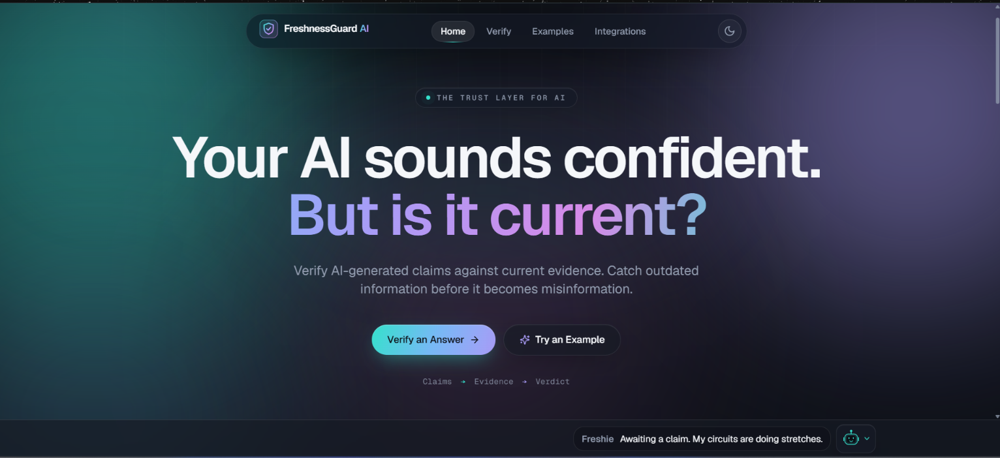
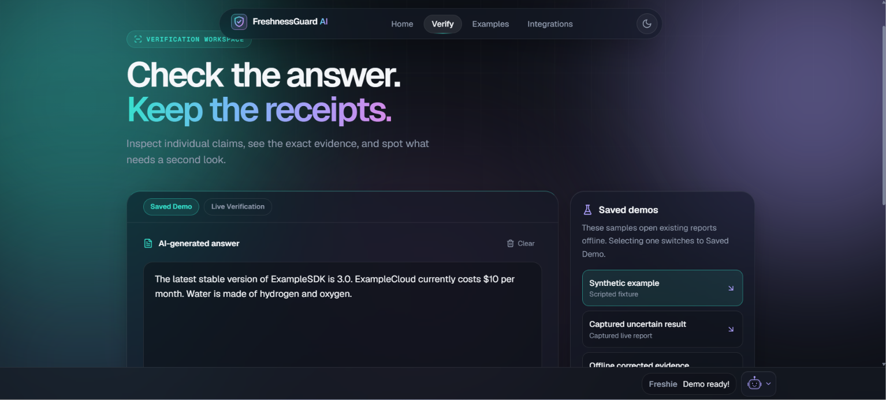
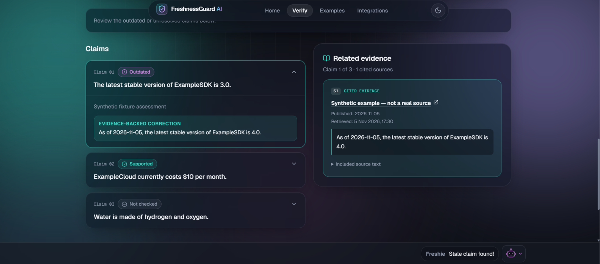
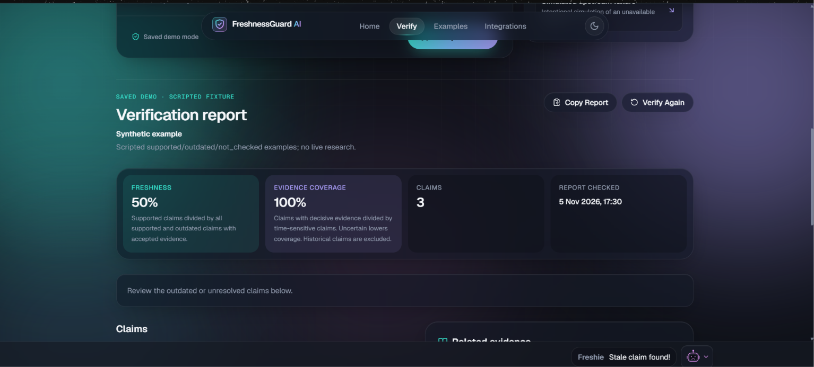
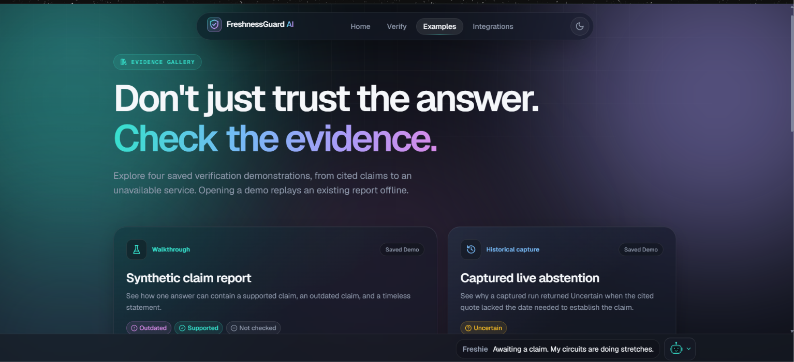
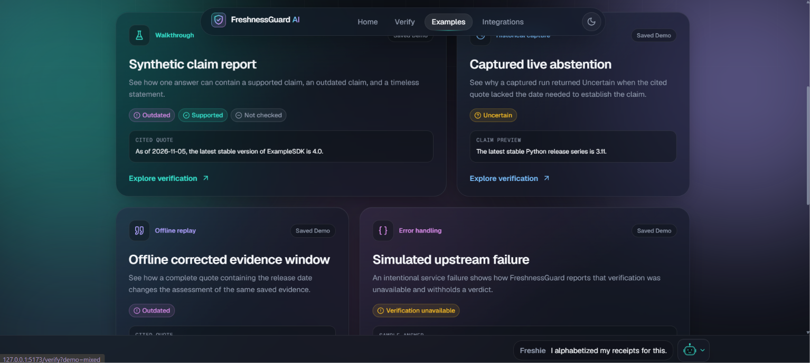
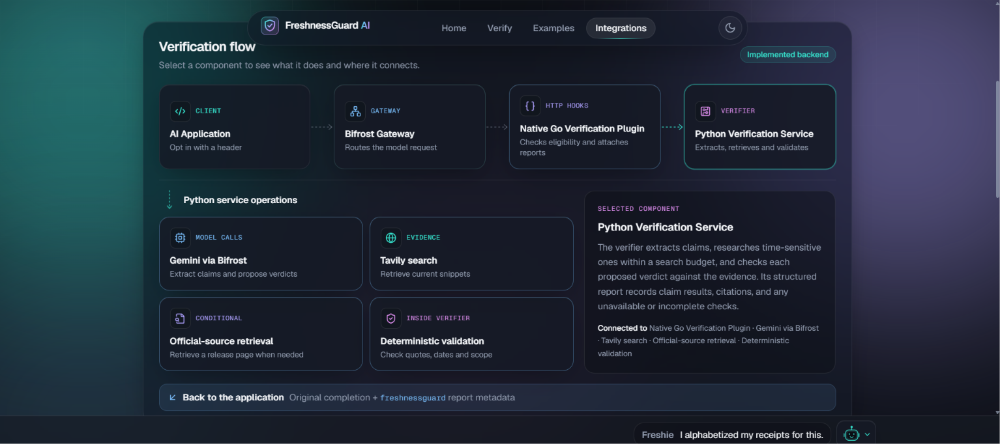
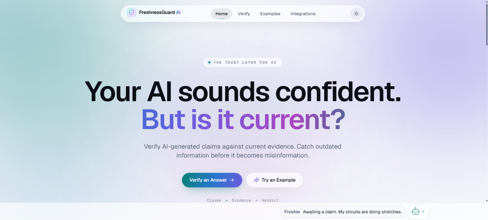

# 🛡️ FreshnessGuard AI
### AI Answers Have an Expiry Date.

**An evidence-backed freshness verification layer for AI-generated answers, powered by Bifrost and Tavily.**

FreshnessGuard AI helps identify when time-sensitive information in an AI-generated answer may be outdated, unsupported, or uncertain.

Instead of blindly trusting a confident response, FreshnessGuard extracts individual claims, retrieves relevant external evidence, validates citations, and produces an explainable freshness report — **without silently changing the original answer.**

**Built for the Global AI Hackathon 2026 | Bifrost + Tavily**

[](https://github.com/apoorv2202/freshnessguard-ai)


---

## 🎬 See FreshnessGuard AI



*FreshnessGuard AI — a browser-based workbench for investigating the freshness of AI-generated answers.*

### 🎥 Watch the Live Demo

[▶️ Watch FreshnessGuard AI — Live Hackathon Demonstration](https://drive.google.com/file/d/15i9kHjsxAcz9NpkxW25dkydu5meLvKhY/view)

The demonstration showcases the working Bifrost + Gemini + Tavily integration, live claim verification, evidence-backed corrections, freshness scoring, and official-source citations.

### 📊 Project Presentation

**[📊 View Final Pitch Deck (PPTX)](docs/FreshnessGuard-AI-Final-Submission.pptx)**

**[📄 View Final Pitch Deck (PDF)](docs/FreshnessGuard-AI-Final-Submission.pdf)**

The presentation covers the problem, proposed solution, verification pipeline, Bifrost and Tavily integrations, demonstrations, and validation results.

### Project Availability

| Resource | Availability |
|---|---|
| Source code | Available in this repository |
| Pitch deck | Available in `docs/` |
| Product screenshots | Available in `docs/screenshots/` |
| Saved browser demonstrations | Available locally |
| Python verification service | Available locally |
| Native Bifrost plugin | Source and build instructions available |
| Public hosted application | Not yet deployed |

**Note:** FreshnessGuard AI is currently a locally runnable prototype. The screenshots demonstrate the application interface and saved verification scenarios; they are not evidence of a currently hosted production service.

---

## 🌍 The Problem

### AI answers can become outdated.

AI models can produce fluent and convincing answers that no longer reflect the latest available information.

Consider questions such as:

- What is the latest stable version of Python?
- Is a particular software API still supported?
- Which version of a framework should developers use?
- Has a product or service changed recently?
- Is an AI-generated technical recommendation still valid?

An answer might have been accurate when generated but become outdated later.

Even citations do not automatically solve this problem. A source might be irrelevant, stale, incomplete, or insufficient to support the claim.

### Our Solution

FreshnessGuard introduces an independent verification layer that:

1. Preserves the original AI-generated answer.
2. Extracts verifiable claims from the response.
3. Identifies time-sensitive information.
4. Retrieves external evidence using Tavily.
5. Evaluates evidence through model-assisted and deterministic checks.
6. Validates citations and quotations.
7. Produces claim-level freshness verdicts.
8. Explicitly reports uncertainty when the available evidence is insufficient.

**Our goal is not to claim that every answer can be verified. Our goal is to make the evidence — and its limitations — visible.**

---

## 🖥️ Product Showcase

### 1. Interactive Verification Workspace



The verification workspace provides an interface for submitting AI-generated answers and exploring verification results.

Users can investigate individual claims and review the available evidence rather than relying on a single overall confidence label.

The frontend supports saved demonstrations and an explicitly enabled local live-verification mode.

### 2. Claim-Level Verification and Evidence



FreshnessGuard analyzes individual claims and presents their verification outcomes.

Depending on the result, the report can include:

- The original extracted claim.
- A supported, outdated, uncertain, or unavailable verdict.
- Evidence quotations.
- Source citations.
- Explanations for the assessment.
- Suggested corrections when qualifying evidence establishes that a claim is outdated.

The original answer remains unchanged.

### 3. Freshness Verification Report



FreshnessGuard generates an inspectable report with freshness metrics, evidence coverage, and claim-level results.

**The scores displayed in this screenshot belong to a saved demonstration scenario. They are not general accuracy or reliability benchmarks.**

### 4. Interactive Example Gallery



The Examples page provides repeatable demonstrations of the verification workflow.



Demonstrations include synthetic fixtures, previously captured live observations, and offline evidence replays.

Each category should be interpreted according to its stated provenance. A saved demonstration is not a fresh live verification.

### 5. System Integrations



FreshnessGuard combines several components:

- **Bifrost:** AI gateway and native plugin integration.
- **Go:** Native plugin implementation.
- **Python:** Claim extraction, evidence assessment, and reporting.
- **Tavily:** External evidence retrieval.
- **Gemini:** Model-provider integration through a configured Bifrost gateway.
- **React:** Interactive verification workbench.

### 6. Light Theme



The frontend includes both dark and light visual themes.

---

## ⚙️ How FreshnessGuard Works

```text
                USER PROMPT
                     |
                     v
              AI MODEL RESPONSE
                     |
                     v
           +----------------------+
           | Original AI Answer   |
           | Preserved Unchanged  |
           +----------------------+
                     |
                     v
           +----------------------+
           | Claim Extraction     |
           | Bifrost-Routed Model |
           +----------------------+
                     |
                     v
           +----------------------+
           | Time-Sensitive Claim |
           | Selection            |
           +----------------------+
                     |
                     v
           +----------------------+
           | Tavily Search        |
           | Evidence Retrieval   |
           +----------------------+
                     |
                     v
           +----------------------+
           | Source Ranking       |
           | Evidence Filtering   |
           +----------------------+
                     |
                     v
           +----------------------+
           | Model Assessment +   |
           | Deterministic Checks |
           +----------------------+
                     |
                     v
           +----------------------+
           | Freshness Report     |
           | Verdicts + Citations |
           +----------------------+
```

### Verification Pipeline

**Step 1 — Claim extraction**

A model routed through Bifrost extracts concrete claims grounded in exact spans of the original answer.

**Step 2 — Time-sensitivity analysis**

The verifier selects claims that may depend on changing information.

**Step 3 — Evidence retrieval**

Tavily searches for relevant external evidence using bounded search requests.

**Step 4 — Evidence assessment**

The system evaluates retrieved evidence using model judgment and deterministic validation rules.

**Step 5 — Citation validation**

The verifier checks whether cited sources and proposed quotations satisfy the applicable evidence requirements.

**Step 6 — Report generation**

FreshnessGuard produces verdicts, citations, evidence coverage, freshness metrics, and diagnostic information.

---

## ✨ Key Features

### 🔒 Original Answer Preservation

FreshnessGuard does not silently rewrite the AI-generated response.

Verification results are presented separately from the original answer.

### 🧠 Atomic Claim Extraction

Concrete claims are extracted from the original response.

Malformed extraction results and claims that cannot be grounded in the original answer are rejected.

### 🔎 Tavily-Powered Evidence Retrieval

Time-sensitive claims trigger targeted searches for supporting or contradicting evidence.

Results are ranked and filtered before assessment.

### 📚 Evidence and Citation Validation

The verifier can check:

- Whether a citation identifier corresponds to retrieved evidence.
- Whether a quoted passage appears in the source content.
- Whether required release dates or version information are present.
- Whether applicable official-source policies are satisfied.
- Whether supported deterministic release checks pass.

Exact quotation matching establishes provenance, not independent factual truth.

### 📊 Explainable Verification Reports

Reports expose claim-level decisions, evidence quotations, citation URLs, proposed corrections, and diagnostics.

### 🛑 Explicit Uncertainty

When the system cannot establish a decisive result, it can abstain rather than invent a confident conclusion.

### 🔁 Recursion Prevention

Internal verifier model calls are designed not to trigger another native verification cycle.

### 🧪 Reproducible Saved Demonstrations

Saved scenarios allow the browser interface to be explored without requiring external API credentials.

---

## 🏷️ Verification Verdicts

| Verdict | Meaning |
|---|---|
| `supported` | Accepted evidence supports the checked claim |
| `outdated` | Accepted evidence establishes that the claim is stale |
| `uncertain` | Evidence is insufficient for a decisive conclusion |
| `not_checked` | The claim was not selected for freshness verification |
| `unavailable` | A verification dependency or operation failed |

FreshnessGuard distinguishes between a claim that is outdated and a claim that simply lacks sufficient evidence.

---

## 📊 Freshness Score and Evidence Coverage

### Freshness Score

```text
Freshness Score =
100 × Supported / (Supported + Outdated)
```

Only time-sensitive claims with accepted decisive evidence contribute to this score.

If no qualifying decisive verdict exists, the score is not assessed.

### Evidence Coverage

```text
Evidence Coverage =
Evidence-backed time-sensitive claims
-------------------------------------
All extracted time-sensitive claims
```

Uncertain claims reduce evidence coverage.

Historical or other `not_checked` claims are excluded from the time-sensitive denominator.

**A high freshness score with low evidence coverage does not mean the entire answer has been verified.**

---

## 🧠 Bifrost Integration

FreshnessGuard includes a native Go HTTP transport plugin using Bifrost's shared-object plugin loading mechanism.

Compatible non-streaming chat completions can opt into verification with:

```http
x-freshnessguard: verify
```

The native integration supports:

- Request and response hooks.
- Opt-in verification.
- Original answer preservation.
- Internal-request recursion prevention.
- Bounded verification deadlines.
- Explicit verification failure reporting.
- Compatible non-streaming text chat responses.

The integration is advisory rather than an authorization or enforcement boundary.

**Streaming verification is not supported by the current native plugin.**

---

## 🔍 Tavily Integration

Tavily provides the external evidence retrieval layer.

FreshnessGuard uses targeted queries to retrieve candidate evidence for time-sensitive claims.

The retrieval pipeline includes:

- Claim-specific searches.
- Source ranking.
- Official-source preference for supported release topics.
- Exact quotation validation.
- Limited official-page retrieval when needed.
- Explicit abstention when evidence requirements are not met.

A search result is not automatically treated as proof.

---

## 🧪 Testing and Validation

FreshnessGuard has been evaluated using local regression tests, scripted benchmarks, native plugin checks, and Bifrost gateway integration tests.

### Previously Reported Local Release Results

| Test Category | Reported Result |
|---|---|
| Python regression tests | 173 passed |
| Frontend tests | 14 passed |
| Frontend production build | Passed |
| Reliability benchmark | 25/25 passed |
| Protocol benchmark | 8/8 passed |
| Acquisition scenarios | 4/4 passed |
| Bifrost gateway smoke tests | 13/13 passed |
| Native Go race tests | Passed |
| Native plugin loader smoke | Passed |

These results come from previously reported local release executions.

The scripted evaluations use controlled evidence and provider responses. They do not establish general real-world fact-checking accuracy.

**These figures should not be interpreted as results from the latest restricted-environment execution or as proof that all current live-provider checks pass.**

### Gateway Smoke Scenarios

**Qualifying official release evidence**

A dated official Python release fixture satisfied the required evidence checks.

```text
Verdict: OUTDATED
Citation: Accepted
Evidence: Qualifying dated release passage
```

**Nonqualifying release evidence**

A fictional ExampleSDK release claim used evidence from a source that did not satisfy the applicable official-source policy.

```text
Verdict: UNCERTAIN
Citation: Not accepted
Evidence: Insufficient for a decisive verdict
```

These controlled scenarios test whether the verifier accepts qualifying evidence and abstains when the requirements are not satisfied.

---

## 🎬 Demonstration Provenance

### Successful Live Verification — November 10, 2026

A live end-to-end verification was completed using Bifrost, Gemini, Tavily, and FreshnessGuard's deterministic validation pipeline.

**Claim:** The latest stable Python release series is 3.11.

**Observed result:**
- Verdict: `OUTDATED`
- Freshness score: `0%`
- Evidence coverage: `100%`
- Accepted citations: `1`
- Evidence: Official Python 3.14.0 stable release page
- Release date: October 7, 2025

The system identified the claim as outdated and presented an evidence-backed correction with inspectable source text.

This was a live verification, not an offline replay. Earlier uncertain results and offline corrected-evidence replays are documented separately below.

---

### Example Claim

> The latest stable Python release series is 3.11.

### Captured Live Verification — November 6, 2026

```text
Claim:
The latest stable Python release series is 3.11.

Verdict:
UNCERTAIN

Reason:
The proposed evidence quotation omitted
the release date required by the verifier.

Accepted citations:
None
```

The verifier abstained because the proposed quotation did not satisfy the release-evidence requirements.

### Separate Offline Corrected-Evidence Replay

```text
Claim:
The latest stable Python release series is 3.11.

Verdict:
OUTDATED

Evidence:
A complete dated release passage.

Mode:
Offline corrected-evidence replay.
```

This replay used saved evidence without new model, search, or page-retrieval calls.

It is not another live verification.

### Recommended Judge Demonstration

For a repeatable walkthrough, use the frontend's **Saved Demo** experience.

The saved examples demonstrate evidence handling, uncertainty, and simulated upstream failures without depending on external provider availability.

---

## 🚀 Run FreshnessGuard AI Locally

### Prerequisites

For the browser workbench:

- Node.js 22 or newer.
- npm.

For the Python verifier:

- Python 3.11 or newer.

Native plugin builds additionally require a compatible Go toolchain, Linux/WSL, and CGO build dependencies.

### 1. Clone the Repository

```bash
git clone https://github.com/apoorv2202/freshnessguard-ai.git
cd freshnessguard-ai
```

### 2. Run the Saved Browser Demo

On Windows PowerShell:

```powershell
npm.cmd ci --prefix frontend

Remove-Item Env:FRESHNESSGUARD_ENABLE_LIVE -ErrorAction SilentlyContinue

npm.cmd run dev --prefix frontend
```

Open the local URL displayed by Vite.

Navigate to **Examples** and select a saved scenario.

This mode does not require Gemini credentials, Tavily credentials, Bifrost, or the Python verifier.

### 3. Run the Offline Python Demo

From the repository root:

```powershell
python -m freshnessguard.cli demo

python -m scripts.render_demo

Start-Process ./demo/report.html
```

The generated report demonstrates the verification report format using scripted model decisions and evidence.

### 4. Run Python Regression Tests

```powershell
python -m unittest discover -s tests -v
```

### 5. Run the Offline Benchmark

```powershell
python -B -m benchmarks.final_offline
```

These tests evaluate implementation behavior using local scenarios. They are not live-world accuracy benchmarks.

---

## 🛠️ Standalone Python Verification Service

Start the verifier using synthetic evidence:

```powershell
python -m freshnessguard.cli serve --fixture
```

In another PowerShell terminal:

```powershell
$body = @{
    answer = 'The latest stable version of ExampleSDK is 3.0.'
} | ConvertTo-Json

Invoke-RestMethod `
    http://127.0.0.1:8765/verify `
    -Method Post `
    -ContentType application/json `
    -Body $body
```

This enables local inspection of verification results without external providers.

---

## 🔐 Environment Configuration

For live verification, create a local environment file:

```powershell
Copy-Item .env.example .env
```

Configure the required values:

| Variable | Purpose |
|---|---|
| `BIFROST_URL` | Bifrost OpenAI-compatible base URL |
| `BIFROST_MODEL` | Configured provider/model identifier |
| `BIFROST_VIRTUAL_KEY` | Gateway virtual key, if required |
| `TAVILY_API_KEY` | Tavily API credential |
| `FRESHNESSGUARD_TOKEN` | Local verifier authentication token |

Configure the Gemini provider credential in Bifrost itself.

The verifier token must contain at least 24 characters and must match between the relevant verifier, gateway plugin, and frontend server-side configuration.

**Never commit `.env`, provider credentials, or authentication tokens to GitHub.**

Do not expose server-side credentials in client-side `VITE_*` environment variables.

---

## 🌐 Local Live Verification

Live verification requires three locally running components.

### Terminal 1 — Bifrost Gateway

Start a configured Bifrost gateway on local port `8080`.

The gateway must have a working model-provider configuration.

If using the native plugin, ensure it is loaded successfully and can communicate with the Python verifier.

A reachable port alone does not establish provider or plugin readiness.

### Terminal 2 — Python Verifier

From the repository root:

```powershell
python -m freshnessguard.cli serve --env-file .env --port 8765
```

### Terminal 3 — React Frontend

From the repository root:

```powershell
Set-Location frontend

$env:FRESHNESSGUARD_TOKEN = [System.Net.NetworkCredential]::new(
    '',
    (Read-Host 'Verifier token' -AsSecureString)
).Password

$env:FRESHNESSGUARD_ENABLE_LIVE = '1'

npm.cmd run dev
```

Open the local Verify page.

Before attempting live verification, confirm that:

- Bifrost is reachable.
- The model provider is configured correctly.
- The selected model supports the required structured output.
- Tavily credentials are valid.
- Provider quotas are available.
- The verifier authentication token matches.

Live verification can consume model-provider and Tavily credits.

---

## 🐧 Native Bifrost Plugin — WSL Ubuntu

FreshnessGuard's native Go integration uses Bifrost's shared-object plugin loader.

The inspected upstream Bifrost revision was:

```text
afdce01b50a78199f59e38117cd4d5952d038b07
```

The inspected upstream modules declared Go `1.27.3`.

A compatible Go toolchain, C build tools, CGO, and matching gateway/plugin build settings are required.

### Build the Plugin

```bash
bash scripts/build-plugin.sh
```

### Run Native Loader Smoke Tests

```bash
python3 -m scripts.native_smoke --upstream "$PWD/work/bifrost"
```

### Build the Gateway

```bash
bash scripts/build-gateway.sh
```

### Run Gateway Smoke Tests

```bash
python3 -m scripts.gateway_smoke
```

The gateway smoke tests exercise the actual Bifrost HTTP gateway, native plugin, and verifier using controlled local provider responses and evidence.

They do not require live paid-provider calls.

### Native Integration Notes

- Build the gateway and plugin with compatible upstream source and toolchain settings.
- Use a dynamically linked gateway compatible with the shared-object loader.
- Merge `integrations/bifrost/config.fragment.json` into the gateway configuration.
- Configure the absolute Linux path to the `.so` plugin.
- Ensure the gateway can reach the verifier.
- Configure matching authentication tokens.
- Do not assume Windows loopback addresses are reachable from WSL.

A normal static Bifrost release executable is not interchangeable with the dynamically linked build required by this integration.

---

## 🧰 Repository Structure

```text
freshnessguard-ai/
│
├── .github/
│   └── workflows/
│
├── benchmarks/
│   └── Scripted evaluations and benchmark utilities
│
├── demo/
│   ├── report.html
│   └── report.json
│
├── docs/
│   ├── FreshnessGuard-AI-Final-Submission.pptx
│   ├── FreshnessGuard-AI-Final-Submission.pdf
│   └── screenshots/
│       ├── 01-homepage-dark.png
│       ├── 02-verification-workspace.png
│       ├── 03-claims-and-evidence.png
│       ├── 04-verification-report.png
│       ├── 05-examples-gallery.png
│       ├── 06-demo-scenarios.png
│       ├── 07-system-integrations.png
│       └── 08-homepage-light.png
│
├── freshnessguard/
│   └── Core Python verification system
│
├── frontend/
│   └── React browser workbench
│
├── integrations/
│   └── Native Bifrost plugin
│
├── scripts/
│   └── Build, smoke-test, and demo utilities
│
├── tests/
│   └── Python regression tests
│
├── .env.example
├── .gitignore
├── LICENSE
├── pyproject.toml
└── README.md
```

Some build artifacts, local credentials, and benchmark outputs are generated locally and are not committed.

---

## 🛡️ Reliability and Safety Design

### Deterministic Evidence Gates

Decisive verdicts require qualifying citations and evidence quotations.

Supported release topics also use deterministic source and version checks.

### Resource Limits

The implementation bounds:

- Input answer length.
- Number of extracted claims.
- Claims selected for search.
- Search and model request budgets.
- Source content size.
- Official-page retrieval.
- Concurrent verification requests.

### Rate-Limit Handling

Provider HTTP 429 responses can interrupt verification.

The resulting report makes the failure explicit rather than pretending the verification succeeded.

### Failure Transparency

Verification failures preserve the original answer and report an unavailable or uncertain state where appropriate.

A completed report does not necessarily mean every claim was verified.

---

## ⚠️ Known Limitations

FreshnessGuard AI is a research-oriented prototype, not a universal fact-checking guarantee.

- Native verification supports compatible non-streaming text chat completions.
- Some claims may not be extracted or checked.
- General semantic assessment remains model-assisted.
- Exact quotation matching verifies provenance, not factual truth.
- Retrieval time does not guarantee source freshness.
- Unsupported release topics may produce uncertain results.
- Provider quotas, latency, and network failures may interrupt verification.
- Multi-claim requests may exceed browser adapter deadlines.
- Gateway timeouts do not necessarily cancel ongoing verifier work.
- The local development service is not a production-grade public API.
- Complete multi-tenant authentication and isolation are not included.
- A public deployment has not yet been completed.

### Privacy Considerations

Answer claims and source excerpts may be sent to the configured model provider.

Search queries are sent to Tavily.

Do not submit sensitive production information without an approved data-handling policy.

Retrieved content is treated as untrusted input, but model-level prompt injection remains a risk.

---

## 📈 Future Improvements

Potential next steps include:

- Expanded official-source policies.
- Additional time-sensitive claim categories.
- More model-provider configurations.
- Improved evidence retrieval efficiency.
- Larger live evaluation datasets.
- More detailed verification analytics.
- Production-ready authentication and tenant isolation.
- Public frontend hosting.
- Secure cloud deployment of the verifier and Bifrost gateway.

These are planned improvements, not currently deployed capabilities.

---

## 📚 Documentation and Resources

| Resource | Location |
|---|---|
| Final pitch deck (PPTX) | [Download PowerPoint](docs/FreshnessGuard-AI-Final-Submission.pptx) |
| Final pitch deck (PDF) | [View PDF](docs/FreshnessGuard-AI-Final-Submission.pdf) |
| Live demonstration video | [Watch Demo (Google Drive)](https://drive.google.com/file/d/15i9kHjsxAcz9NpkxW25dkydu5meLvKhY/view) |
| Product screenshots | [Screenshots](docs/screenshots/) |
| Browser workbench | [`frontend/`](frontend/) |
| Core verification engine | [`freshnessguard/`](freshnessguard/) |
| Bifrost integration | [`integrations/`](integrations/) |
| Benchmark utilities | [`benchmarks/`](benchmarks/) |
| Regression tests | [`tests/`](tests/) |
| Build and demo scripts | [`scripts/`](scripts/) |

The repository includes source code and controlled test scenarios for local inspection and reproduction.

---

## 👨‍💻 Developer

**Apoorv Anand**

Computer Science and Engineering  
RV College of Engineering, Bengaluru

GitHub: [@apoorv2202](https://github.com/apoorv2202)

Project: [FreshnessGuard AI](https://github.com/apoorv2202/freshnessguard-ai)

Developed as a **solo project for the Global AI Hackathon 2026**.

---

## 📄 License

This project is licensed under the MIT License.

See [LICENSE](LICENSE) for details.

---

## ⭐ Final Thought

### AI answers should not require blind trust.

A confident response is not the same as a verified response.

FreshnessGuard AI makes evidence, citations, uncertainty, and verification limitations visible while preserving the original answer.

**Keep the answer. Check the evidence. Make freshness visible.**

Built with **Bifrost + Tavily**.
