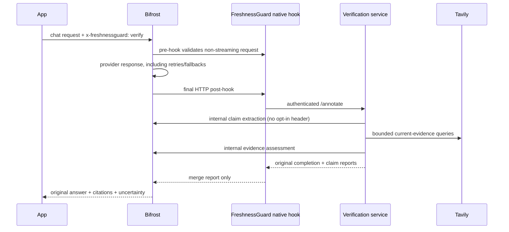
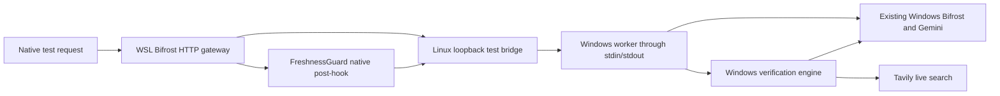

# Upstream integration decision

Review date: 5 November 2026. Repository: [maximhq/bifrost](https://github.com/maximhq/bifrost), pinned checkout `afdce01b50a78199f59e38117cd4d5952d038b07`.

## Evidence inspected

- [`core/schemas/plugin.go`](https://github.com/maximhq/bifrost/blob/afdce01b50a78199f59e38117cd4d5952d038b07/core/schemas/plugin.go): typed HTTP pre/post hooks and per-attempt LLM hooks.
- [`framework/plugins/soloader.go`](https://github.com/maximhq/bifrost/blob/afdce01b50a78199f59e38117cd4d5952d038b07/framework/plugins/soloader.go): native shared-object loader; `GetName` and `Cleanup` required, hook symbols optional.
- [`transports/bifrost-http/handlers/middlewares.go`](https://github.com/maximhq/bifrost/blob/afdce01b50a78199f59e38117cd4d5952d038b07/transports/bifrost-http/handlers/middlewares.go): transport post-hook execution and response application. Request and response structures are pooled and must not be retained after hook return.
- [`transports/config.schema.json`](https://github.com/maximhq/bifrost/blob/afdce01b50a78199f59e38117cd4d5952d038b07/transports/config.schema.json): plugin configuration requires `name` and `enabled`, with a dynamic `path` and free-form `config`.
- [`examples/plugins/http-transport-only`](https://github.com/maximhq/bifrost/tree/afdce01b50a78199f59e38117cd4d5952d038b07/examples/plugins/http-transport-only): an existing supported extension pattern.
- [`docs/plugins/building-dynamic-binary.mdx`](https://github.com/maximhq/bifrost/blob/afdce01b50a78199f59e38117cd4d5952d038b07/docs/plugins/building-dynamic-binary.mdx) and `core/go.mod`: dynamic-build constraint and actual compiler version. Some examples in the prose contain old versions; module directives take priority.

A search of inspected OSS plugins and feature docs did not find claim-level stale-answer verification. Tavily relay references already exist in logging, governance and telemetry tests; merely exposing Tavily is not a missing feature. This absence assessment is scoped to the checked repository, not private enterprise code, all open PRs or a maintainer acceptance decision.

## Chosen seam

Using the final HTTP post-hook avoids repeated research on provider fallback attempts. It is limited to HTTP chat completions; Go SDK calls and other endpoint schemas are outside MVP scope. `PostLLMHook` could support SDK-native reports later, but would need per-attempt semantics and a stable report field.

Native hook disabled path: opt-in header check, no response parsing, network calls or retained state. Enabled path: bounded JSON objects and synchronous verifier roundtrip, with a reused HTTP client. The service retains only two active requests, each with <=8 claims, <=5 searches, <=4 snippets/search, <=5,000 characters/snippet. No persistent cache, claim database, request-ID map or stream buffer is retained. Disabled path is benchmarked in `main_test.go`; enabled network latency must be measured live.

The service is a replaceable Python component to keep solo Windows development fast. The native adapter is an actual Bifrost extension; the standalone API alone would not establish the Bifrost track contribution. This is a candidate upstream integration, not an accepted upstream feature or merged PR.

## Reliability additions

Extraction now requires a concrete subject present in claim text. Known entity policies guide Tavily toward official domains and require an official decisive citation. Conflicts, future-dated evidence and unsupported quote/correction output abstain. Corrections remain exact source excerpts; whitespace normalization resolves back to exact original spans. Original answers whose provider finish reason is `length` or `content_filter` skip all research and receive an incomplete report. These are defensive gates; entity grounding and quote provenance do not establish semantic entailment.

The native adapter adds a bounded per-request deadline, validates the service report envelope, and marks malformed/failed verification unavailable. It does not retain pooled request/response data or silently rewrite generation text. Source snippets, prompts and answers are never logged by the Python service. The explicit source registry is small, other entities remain unassessed, and the model can still miss claims or misunderstand dates.

## Observed Windows/WSL live-test topology

This is isolated test infrastructure for WSL NAT, not a new production architecture. Credentials remain in Windows `.env`/gateway configuration; the bridge never receives credential arguments. Existing gateways are not reconfigured. Production deployment should colocate gateway and verifier in one network namespace as originally designed. The first observed live native roundtrip failed semantic review because of truncated generation; its corrected final-revision rerun remains quota-blocked. See `LIVE_RESULTS.md`.

## Upstream contribution path

Propose an opt-in example/plugin and documented report contract first. Ask maintainers whether a built-in module is desired. A built-in implementation would need operator configuration, SDK semantics, tests in Bifrost's existing provider harness, config schema/UI changes and measured enabled-path overhead. No maintainer was contacted and no PR was opened by this task.
