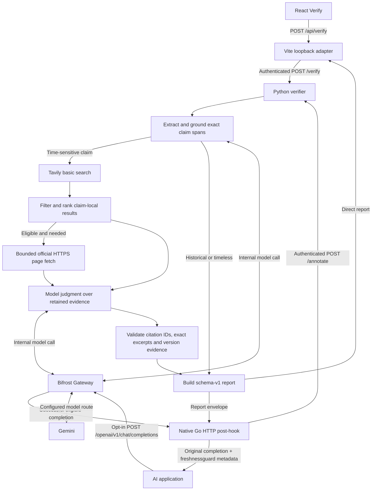

# Bifrost and Tavily integration proof

FreshnessGuard adds an evidence report to an existing answer. **Bifrost routes model requests** for claim extraction and judgment. **Tavily supplies external search results** for claims that can go stale. The Python verifier owns evidence selection, citation acceptance, deterministic release checks and scoring. Each technology has a separate role in the verification path.

## Implemented architecture



The browser path calls the verifier directly through the same-origin adapter. The verifier's model calls still pass through Bifrost. The native path begins with an opted-in generation request. Its post-hook sends the existing completion to the verifier and merges only the `freshnessguard` metadata into the original response. The hook skips internal verifier calls, preventing recursive verification. It requires a successful, eligible non-streaming chat completion and fails open with explicit unavailable metadata when verification fails. Native transport status `checked` does not establish a claim verdict. [Vite adapter](../frontend/server/verifyAdapter.mjs) · [Python routes](../freshnessguard/server.py) · [Go hooks](../integrations/bifrost/main.go)

## Trace through the current code

1. **Extraction through Bifrost.** The verifier sends the answer and extraction prompt to the configured OpenAI-compatible `/chat/completions` endpoint, using the server-side model identifier and optional virtual key. Calls are non-streaming and marked `x-freshnessguard-internal: 1`. Gemini extraction requests a JSON schema. Local code still validates the output, including contiguous verbatim spans, grounded subjects and boolean time-sensitivity flags. Invalid extraction stops before search. Historical and timeless claims go to `not_checked`. [Model client](../freshnessguard/clients.py) · [Extraction and verification loop](../freshnessguard/engine.py)
2. **Search through Tavily.** For each eligible claim, the verifier builds a search query. Version queries target release indexes, with official-domain policies for known entities. The Python client calls Tavily's basic search with result bounds and requests usage and publication metadata. It inspects at most eight results and retains up to four snippets per claim after ranking and filtering. For Python, Java and Node.js version queries, clearly unrelated off-domain results are dropped. Retained snippets are context until a citation passes validation. [Search client](../freshnessguard/clients.py) · [Source policy and ranking](../freshnessguard/evidence.py)
3. **Optional official retrieval.** If snippets lack sufficient proof for a latest-version claim, the verifier can fetch an allowlisted official HTTPS page directly, with at most one attempt per claim and two per answer by default. The fetch rejects redirects and non-public addresses and bounds time and size. Explicit prerelease links are skipped for stable/LTS checks. Fetched text retains source ID, URL, retrieval time and acquisition provenance. This step uses the project's HTTPS retriever. Tavily supplies the search results that can lead to that page. [Retrieval and URL policy](../freshnessguard/retrieval.py)
4. **Judgment through Bifrost.** A second stage sends the claim and retained evidence to the same configured model route in JSON object mode. An eligible newer-release passage can be presented as a backend-selected exact quote. The model proposes a verdict and selects evidence. When no source survives selection, judgment is skipped. [Judgment and candidate selection](../freshnessguard/engine.py)
5. **Acceptance in Python.** A decisive proposal needs valid source IDs, matching contiguous excerpts, no unresolved reported conflict and qualifying authority where required. Whitespace-only transcription can resolve to the original contiguous span. Invented words, punctuation and stitched fragments do not qualify. A correction must be a cited excerpt. For latest-version claims, the deterministic version guard also checks the relevant entity, version scope, release channel, date and authority. An older stable release page alone cannot prove that version is current. Missing proof yields uncertainty. [Citation validation](../freshnessguard/engine.py) · [Version validation](../freshnessguard/semantics.py)

The demonstrated gateway route uses the configured Gemini model. These traces establish routing through Bifrost and the separately tested native hook. They establish no provider fallback, load-balancing behavior, response caching or quota enforcement at the gateway.

## Sanitized example from the saved record

**Claim:** “The latest stable Python release series is 3.11.”

**Captured live abstention, 6 November 2026.** Extraction produced one eligible claim. Tavily was queried for `Python latest stable releases downloads versions release dates https://www.python.org/downloads/ https://devguide.python.org/versions/`. Four snippets were retained. The verifier followed a release-page reference from the release blog snippet `s1` and assigned the [official Python 3.14.0 page](https://www.python.org/downloads/release/python-3140/) ID `s5`. Gemini proposed `outdated` and cited `s5` with only “This is the stable release of Python 3.14.0”. That text matched the page, but omitted the adjacent release date. The validator found a dated release in the source and none in the proposed quote. The captured report stayed `uncertain`, with zero accepted citations, 0% coverage and freshness not assessed. Recorded usage was two logical model calls, one Tavily search and one reported credit, and one official fetch. Total latency was 11.92 seconds. [Captured report](../frontend/fixtures/saved-live-uncertain.json) · [Original diagnosis](TARGETED_LIVE_DIAGNOSIS_AND_FREEZE.md)

**Offline replay of identical saved sources.** The saved replay selects this exact contiguous passage from `s5`, including the original blank line:

```text
Release date: Oct. 7, 2025

This is the stable release of Python 3.14.0
```

The current validator accepts the complete passage as evidence of a dated newer stable release in the claimed series scope. The replay reports `outdated`, one accepted citation, 100% coverage and freshness 0/100. It disproves the 3.11 superlative without identifying the latest release today. The replay retains the original check timestamp and source provenance, and has zero new model calls, searches or page fetches. [Offline replay](../frontend/fixtures/offline-replay-outdated.json)

**Separate live browser smoke, 8 November 2026 IST.** The same claim returned one evidence-backed `outdated` result through Vite, with one accepted official citation, 100% coverage and freshness 0/100. The historical record reports 9.66 seconds, two Gemini calls through Bifrost totaling 6,669 tokens with zero recorded gateway retries, one Tavily search with one reported credit and one official-page fetch. This is an earlier-revision, one-claim live observation. [Measured live record](LIVE_RESULTS.md#final-browser-smoke-run--8-november-2026-ist)

## Native proof and its boundary

The recorded gateway fixture loaded the native plugin into the pinned OSS Bifrost build. It exercised extraction and judgment over the actual gateway HTTP transport, report delivery, preserved answers, opt-out, recursion prevention, streaming rejection and explicit failure behavior. Its model responses came from a loopback scripted provider, and its search responses were fixtures. The earlier real-provider native roundtrip transported the report but failed semantic review after truncated generation. The decisive live observation above belongs to the browser path. [Gateway fixture](../benchmarks/gateway-smoke.json) · [Native live artifact](../benchmarks/native-live.json) · [Benchmark audit](BENCHMARK_REPORT.md)
